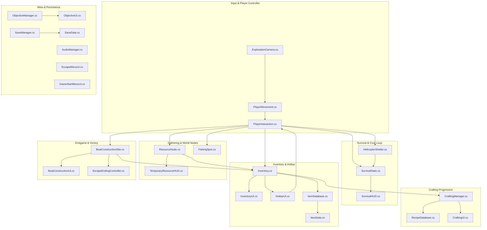

# STRANDED: Project Architecture & Script Study Guide

> **Project Name:** STRANDED  
> **Engine:** Unity 6 (6000.5.3f1)  
> **Genre:** 2D Top-Down Pixel-Art Survival & Crafting  
> **Purpose:** Comprehensive learning reference explaining how each script functions, interacts with other systems, and affects the game.

---

## 1. High-Level Architecture Overview

STRANDED is structured into **8 modular subsystems**. Below is the architectural relationship map showing how the scripts communicate:

---

## 2. Core Player & Controller Layer

### 1. [`PlayerMovement.cs`](file:///d:/Unity/Projects/STRANDED/Assets/Scripts/PlayerMovement.cs)
* **What it does:** Reads 2D movement input (`WASD`, arrow keys, or gamepad left-stick) using Unity's New Input System. Drives the player's `Rigidbody2D.linearVelocity` and switches directional walk/idle animations in `Animator`.
* **Unique Mechanics:**
  * **Shoreline Wading Physics:** Detects when the player's feet touch shallow ocean or river water tilemaps. Reduces movement speed (`wadeSpeedMultiplier = 0.32f`) and plays slower wading animations.
* **How it affects the game:** Controls how the player moves and feels. Prevents the player from walking through obstacles (trees, boulders, helicopter fuselage, deep ocean colliders).

### 2. [`PlayerInteraction.cs`](file:///d:/Unity/Projects/STRANDED/Assets/Scripts/PlayerInteraction.cs)
* **What it does:** The central brain for player actions. Detects whatever the player is facing or standing near.
* **Key Responsibilities:**
  * Detects interactable targets: [`ResourceNode`](file:///d:/Unity/Projects/STRANDED/Assets/Scripts/ResourceNode.cs), [`FishingSpot`](file:///d:/Unity/Projects/STRANDED/Assets/Scripts/FishingSpot.cs), [`HelicopterShelter`](file:///d:/Unity/Projects/STRANDED/Assets/Scripts/HelicopterShelter.cs), [`BoatConstructionSite`](file:///d:/Unity/Projects/STRANDED/Assets/Scripts/BoatConstructionSite.cs), and open water (for drinking).
  * Executes the **`[E]` key** action (harvesting, resting, contributing materials, fishing).
  * Executes the **`[F]` key** quick-consume action to eat food or drink from the selected hotbar slot.
  * Manages the currently equipped tool (`ToolType.StoneAxe`, `ToolType.StonePickaxe`, etc.) and notifies UI and audio.
* **How it affects the game:** Bridges the player's keyboard/mouse inputs to every interactive object in the world.

### 3. [`ExplorationCamera.cs`](file:///d:/Unity/Projects/STRANDED/Assets/Scripts/ExplorationCamera.cs)
* **What it does:** Smoothly lerps the Main Camera to track the player's position with damping.
* **How it affects the game:** Keeps the player centered on screen and clamps camera movement so the camera cannot pan into infinite void beyond island boundaries.

---

## 3. Survival & Shelter Layer

### 4. [`SurvivalStats.cs`](file:///d:/Unity/Projects/STRANDED/Assets/Scripts/SurvivalStats.cs)
* **What it does:** Simulates human biological survival needs:
  * **Hunger (0–100):** Decays slowly over time.
  * **Thirst (0–100):** Decays faster than hunger.
  * **Energy (0–100):** Depleted by chopping, mining, and running; restored by resting.
  * **Health (0–100):** Slowly drains if Hunger or Thirst hits 0 (starvation/dehydration). Takes immediate damage from poisonous food (`-50 HP`).
* **Death & Respawn:** If Health reaches 0, triggers player death and the Game Over respawn modal. Respawning restores vital stats and returns the player to the helicopter base camp.
* **How it affects the game:** Imposes core survival tension. Drives the player to forage for berries/mushrooms, fish for food, and drink clean water.

### 5. [`SurvivalHUD.cs`](file:///d:/Unity/Projects/STRANDED/Assets/Scripts/SurvivalHUD.cs)
* **What it does:** Draws the on-screen survival vitals (Health, Hunger, Thirst, Energy bars) using color-coded pixel-styled meters.
* **How it affects the game:** Gives the player immediate real-time feedback on their physical status, starvation warnings, and shows the "Respawn at Camp" button when dead.

### 6. [`HelicopterShelter.cs`](file:///d:/Unity/Projects/STRANDED/Assets/Scripts/HelicopterShelter.cs)
* **What it does:** Manages the crashed military helicopter (`134.4, 122.7`) as the player's primary home base camp.
* **Key Features:**
  * **Resting Mechanic:** Pressing `[E]` at the helicopter lets the player rest. Shows a visible sleeping survivor sprite inside the broken cabin, restores Energy and Health, accelerates time, and wakes the player up rested.
  * **Camp Hub:** Anchors the campfire, starter tools, and surrounding natural resources.
* **How it affects the game:** Provides safety and stamina restoration, anchoring early-game survival around the crash site.

---

## 4. Inventory, Items & Equipment Layer

### 7. [`ItemData.cs`](file:///d:/Unity/Projects/STRANDED/Assets/Scripts/ItemData.cs)
* **What it does:** The data definition for any item in STRANDED. Stores:
  * ID string (e.g., `"wood"`, `"poison_mushroom"`, `"tool_stone_axe"`).
  * Display Name & Description.
  * Sprite Icon.
  * Item Category ([`ItemType`](file:///d:/Unity/Projects/STRANDED/Assets/Scripts/ItemType.cs)), Resource Type ([`ResourceType`](file:///d:/Unity/Projects/STRANDED/Assets/Scripts/ResourceType.cs)), Tool Type ([`ToolType`](file:///d:/Unity/Projects/STRANDED/Assets/Scripts/ToolType.cs)).
  * Stackability and Max Stack (99 for resources, 1 for tools).
  * Consumable properties (Hunger, Thirst, Health, Energy restored or damaged).
* **How it affects the game:** Every item the player holds, picks up, crafts, or eats is an instance of `ItemData`.

### 8. [`ItemDatabase.cs`](file:///d:/Unity/Projects/STRANDED/Assets/Scripts/ItemDatabase.cs)
* **What it does:** The central static registry of all items. Initializes and provides dictionary lookups by ID, resource type, or tool type.
* **Items Registered:**
  * **Raw Resources:** Wood, Stone, Fiber, Vines.
  * **Edible Foods:** Berries, Coconut, Raw Fish, Cooked Fish, Island Morel, Honeycomb Morel, Golden Chanterelle, Purple Cave Mushroom, Wild Blackberry.
  * **Poisonous Foods:** Crimson Toadstool (-50 HP), Nightshade Berries (-50 HP).
  * **Tools:** Stone Knife, Stone Axe, Stone Pickaxe, Fishing Rod, Improved Knife, Wooden Mallet, Fiber Twister, Weaving Frame.
  * **Processed Materials:** Shaped Wood, Wooden Pegs, Strong Rope, Reinforced Rope, Woven Sailcloth, Reinforced Joints.
  * **Boat Components:** Paddle, Wind-Catching Assembly, Rope Binding Kit, Structural Frame, Reinforced Hull.
* **How it affects the game:** Acts as the single source of truth for all item data in the game.

### 9. [`Inventory.cs`](file:///d:/Unity/Projects/STRANDED/Assets/Scripts/Inventory.cs)
* **What it does:** The backend container storing the player's 36 items across slots:
  * Slots 0–11: Hotbar slots.
  * Slots 12–35: Main backpack storage.
* **Functions:** `AddItem`, `RemoveItem`, `HasItem`, `CanAddItem`, `SwapSlots`, `SplitSlot`. Fires `OnInventoryChanged` event whenever contents change.
* **How it affects the game:** Dictates what the player is carrying, capacity limits, and resource tracking for crafting.

### 10. [`InventorySlot.cs`](file:///d:/Unity/Projects/STRANDED/Assets/Scripts/InventorySlot.cs)
* **What it does:** Represents a single slot containing an `ItemData` reference and an integer `Quantity`.
* **How it affects the game:** Handles slot stacking, decrementing quantities, and clearing when empty.

### 11. [`InventoryUI.cs`](file:///d:/Unity/Projects/STRANDED/Assets/Scripts/InventoryUI.cs)
* **What it does:** Renders the 36-slot backpack grid on screen when pressing **`[Tab]`** or **`[I]`**.
* **Features:**
  * Warm Stardew Valley-inspired wood/parchment pixel aesthetic.
  * Drag-and-drop item movement between backpack and hotbar.
  * Right-click to consume edible/poisonous items.
  * Hover tooltips showing item name, description, and stats.
* **How it affects the game:** The visual interface for inventory management.

### 12. [`HotbarUI.cs`](file:///d:/Unity/Projects/STRANDED/Assets/Scripts/HotbarUI.cs)
* **What it does:** Renders the 12 quick-access slots permanently docked at the bottom of the screen.
* **Features:**
  * Select slots via keyboard numbers `[1]`–`[9]`, `[0]`, `[-]`, `[=]`, or mouse scroll wheel.
  * Automatically equips the selected tool into the player's active hand via `PlayerInteraction.EquipTool()`.
  * Right-click items in the hotbar to consume them directly.
* **How it affects the game:** Gives the player instantaneous access to tools and consumables while exploring.

### 13. [`TemporaryResourceHUD.cs`](file:///d:/Unity/Projects/STRANDED/Assets/Scripts/TemporaryResourceHUD.cs)
* **What it does:** Handles floating on-screen feedback:
  * Displays interaction prompts (e.g., `"[E] Gather Wild Berries"`, `"[E] Chop Tree (Requires Stone Axe)"`).
  * Displays pop-up toast collection notifications in the top-right corner.
* **How it affects the game:** Informs the player what can be interacted with and what was collected.

---

## 5. Gathering, Environment & World Nodes Layer

### 14. [`ResourceNode.cs`](file:///d:/Unity/Projects/STRANDED/Assets/Scripts/ResourceNode.cs)
* **What it does:** The script attached to every harvestable object in the island world (trees, rock boulders, fiber bushes, vine clusters, mushrooms, and berry bushes).
* **Key Mechanics:**
  * **Tool Validation:** Checks if the player has the required tool equipped (e.g., Trees require `ToolType.StoneAxe`, Rocks require `ToolType.StonePickaxe`, Forage requires `ToolType.None`).
  * **Yielding & Inventory:** Gives the appropriate item and quantity to player's inventory upon harvest.
  * **Depletion & Regrowth:** Switches to depleted sprites (or hides the object) and runs a coroutine to **automatically regrow after 45 seconds**.
  * **Sorting Order:** Automatically calculates sprite sorting order based on ground Y coordinates so objects depth-sort correctly with the player.
* **How it affects the game:** Powers all resource gathering across the island.

### 15. [`FishingSpot.cs`](file:///d:/Unity/Projects/STRANDED/Assets/Scripts/FishingSpot.cs)
* **What it does:** Attached to shoreline water hotspots where ripples appear.
* **Mechanics:**
  * Player walks to the shore with a `FishingRod` equipped and presses `[E]`.
  * Simulates fishing cast and bite timer with splash audio and visual effects.
  * Yields raw coastal fish into the player's inventory.
* **How it affects the game:** Provides an alternative, renewable food source alongside foraging.

### 16. [`IslandTilemapRuntimeSync.cs`](file:///d:/Unity/Projects/STRANDED/Assets/Scripts/IslandTilemapRuntimeSync.cs)
* **What it does:** Runs once when the scene loads (`SyncOnSceneLoad` & `Awake`).
* **Responsibilities:**
  * Ensures sand-to-riverbank transition tiles exist at the 42 river mouth contact points.
  * Ensures natural forage nodes (mushrooms & berries) are spawned under `Environment_Resources/Forage`.
* **How it affects the game:** Guarantees seamless visual junctions between sand and river and ensures forage nodes are present even if scene data was freshly initialized.

### 17. [`AnimatedTile.cs`](file:///d:/Unity/Projects/STRANDED/Assets/Scripts/AnimatedTile.cs)
* **What it does:** A custom Unity Tile that cycles through sprite animation frames at a set speed.
* **How it affects the game:** Animates ocean water waves, river currents, and shoreline foam.

---

## 6. Crafting & Progression Layer

### 18. [`CraftingRecipe.cs`](file:///d:/Unity/Projects/STRANDED/Assets/Scripts/CraftingRecipe.cs) & [`CraftingIngredient.cs`](file:///d:/Unity/Projects/STRANDED/Assets/Scripts/CraftingIngredient.cs)
* **What they do:** Data contracts defining:
  * Output item and quantity produced.
  * List of required ingredient items and quantities.
  * Crafting category (Primitive Tools, Advanced Equipment, Processed Materials, Boat Components).
* **How they affect the game:** Define the recipes that govern the player's technological advancement.

### 19. [`RecipeDatabase.cs`](file:///d:/Unity/Projects/STRANDED/Assets/Scripts/RecipeDatabase.cs)
* **What it does:** The central static catalog containing all crafting recipes in STRANDED.
* **Progression Tiers:**
  * **Tier 1 (Primitive Tools):** Stone Knife (Wood + Stone), Stone Axe (Wood + Stone + Fiber), Stone Pickaxe (Wood + Stone + Fiber), Fishing Rod (Wood + Vines).
  * **Tier 2 (Processed Materials):** Shaped Wood (Wood via Axe), Wooden Pegs (Wood via Knife), Strong Rope (Fiber + Vines), Reinforced Rope, Woven Sailcloth.
  * **Tier 3 (Advanced Tools):** Improved Knife, Wooden Mallet, Fiber Twister, Weaving Frame.
  * **Tier 4 (Boat Components):** Paddle, Wind Assembly, Rope Binding Kit, Structural Frame, Reinforced Hull.
* **How it affects the game:** Determines what materials are needed to craft tools and escape boat parts.

### 20. [`CraftingManager.cs`](file:///d:/Unity/Projects/STRANDED/Assets/Scripts/CraftingManager.cs)
* **What it does:** The backend engine that validates and executes crafting.
  * Checks if the player's inventory possesses all required ingredients.
  * Deducts the ingredient quantities atomically.
  * Adds the crafted output item to inventory and plays success audio.
* **How it affects the game:** Handles all crafting transactions safely without item loss or duplication.

### 21. [`CraftingUI.cs`](file:///d:/Unity/Projects/STRANDED/Assets/Scripts/CraftingUI.cs)
* **What it does:** The visual crafting menu toggled with **`[C]`**.
* **Features:**
  * Categorized tabs (Tools, Materials, Boat Parts).
  * Displays recipe outputs, ingredients owned vs needed, and a big "CRAFT" button.
* **How it affects the game:** Allows the player to see what can be built and trigger crafting actions.

---

## 7. Endgame: Escape Boat & Victory Layer

### 22. [`BoatConstructionSite.cs`](file:///d:/Unity/Projects/STRANDED/Assets/Scripts/BoatConstructionSite.cs)
* **What it does:** Manages the coastal construction site located on the south-west beach (`105.5, 95.5`).
* **Stage-by-Stage Construction:**
  1. Stage 0: Site Discovered (Empty scaffold).
  2. Stage 1: Structural Frame (Requires Structural Frame + Wooden Pegs).
  3. Stage 2: Reinforced Hull (Requires Reinforced Hull + Reinforced Joints).
  4. Stage 3: Rigging & Wind Assembly (Requires Wind Assembly + Rope Binding Kit).
  5. Stage 4: Ready for Launch (Requires 2 Paddles).
* **How it affects the game:** The primary milestone progression tracking the player's escape effort.

### 23. [`BoatConstructionUI.cs`](file:///d:/Unity/Projects/STRANDED/Assets/Scripts/BoatConstructionUI.cs)
* **What it does:** Shows the boat assembly interface when approaching the boat site.
* **Features:** Lists missing components for the current stage and provides a "Contribute" button.
* **How it affects the game:** Guides the player step-by-step through the endgame assembly requirements.

### 24. [`EscapeEndingController.cs`](file:///d:/Unity/Projects/STRANDED/Assets/Scripts/EscapeEndingController.cs)
* **What it does:** Triggers when the boat is 100% complete and the player launches it into the ocean.
* **Sequence:**
  * Disables player movement.
  * Animates the boat sailing off the island into open sea with cinematic fading.
  * Displays the Victory Escape screen with total survival days, resources gathered, items crafted, and credits.
* **How it affects the game:** Delivers the satisfying narrative and gameplay conclusion of the game.

---

## 8. Meta Systems, Objectives, Audio & Save/Load

### 25. [`ObjectiveManager.cs`](file:///d:/Unity/Projects/STRANDED/Assets/Scripts/ObjectiveManager.cs) & [`ObjectiveUI.cs`](file:///d:/Unity/Projects/STRANDED/Assets/Scripts/ObjectiveUI.cs)
* **What they do:** A quest tracking system that steps through beginner survival milestones (e.g. *"Inspect Crash Site"*, *"Gather Wood & Stone"*, *"Craft a Stone Axe"*, *"Rest in Helicopter"*, *"Find Boat Construction Site"*).
* **How they affect the game:** Provides gentle early-game guidance so the player always knows what to do next.

### 26. [`SaveManager.cs`](file:///d:/Unity/Projects/STRANDED/Assets/Scripts/SaveManager.cs) & [`SaveData.cs`](file:///d:/Unity/Projects/STRANDED/Assets/Scripts/SaveData.cs)
* **What they do:** Handles persistent state saving to a local JSON file (`Application.persistentDataPath/savegame.json`).
* **Data Saved:**
  * Player position and equipped tool.
  * Full 36 inventory slots with quantities.
  * Health, Hunger, Thirst, and Energy values.
  * World time and day count.
  * Boat construction progress stage.
  * Objective progression.
* **How they affect the game:** Ensures the player's progress is preserved across play sessions.

### 27. [`AudioManager.cs`](file:///d:/Unity/Projects/STRANDED/Assets/Scripts/AudioManager.cs)
* **What it does:** Central audio singleton with dedicated audio channels:
  * Background ambient music (ocean waves, jungle breeze).
  * Footstep sounds (grass vs sand vs shallow water wading).
  * Tool action sound effects (wood chopping, stone mining, bush cutting).
  * Inventory and UI clicks.
* **How it affects the game:** Provides immersive sound feedback for every action in the game.

### 28. [`GameStartMenuUI.cs`](file:///d:/Unity/Projects/STRANDED/Assets/Scripts/GameStartMenuUI.cs)
* **What it does:** Displays the opening game launcher modal upon starting the game.
* **Options:**
  * **Resume Game:** Loads saved game state from disk.
  * **New Game:** Starts a fresh survival run at the crash site.
* **How it affects the game:** Gives a polished entry flow instead of throwing the player into the world without options.

### 29. [`EscapeMenuUI.cs`](file:///d:/Unity/Projects/STRANDED/Assets/Scripts/EscapeMenuUI.cs)
* **What it does:** Listens for the **`[Esc]`** key during gameplay.
* **Options:**
  * **Resume:** Closes the menu and unpauses the game.
  * **Save Game:** Immediately writes current state to disk.
  * **Restart Game:** Prompts for confirmation and restarts the island simulation.
* **How it affects the game:** Standard pause menu allowing restart or saving at any time.

### 30. [`PixelArtFontManager.cs`](file:///d:/Unity/Projects/STRANDED/Assets/Scripts/PixelArtFontManager.cs)
* **What it does:** Automatically discovers and applies the custom pixel-art bitmap font (`pixel_operator.ttf`) to all Unity GUI styles across the project.
* **How it affects the game:** Unifies all UI text with an authentic retro Stardew Valley aesthetic.

---

## 9. Editor Tools & Automation Layer (`Assets/Editor/`)

These scripts only execute inside the Unity Editor to build scenes, place resources, and test systems:

| Editor Script | Purpose & Function |
| :--- | :--- |
| **`IslandTilemapBuilder.cs`** | Generates the entire multi-layered 350×350 tile island map from procedural algorithms and `island_world_350.json`. Builds ocean, sand, grass, cliffs, river, and transition layers. |
| **`IslandTilemapAutoBaker.cs`** | Runs on editor startup. Bakes river-sand transitions, starter camp nodes, and forage nodes directly into `MainScene.unity` so they exist in the scene hierarchy. |
| **`IslandResourcePlacer.cs`** | Scans the island terrain and places balanced distributions of trees, rocks, bushes, and driftwood across biomes. |
| **`VineResourcePlacer.cs`** | Places jungle vine clusters along cliff bases and deep jungle groves. |
| **`FishingSpotPlacer.cs`** | Places interactive coastal fishing ripples along island beaches and riverbanks. |
| **`BoatSitePlacer.cs`** | Places and configures the coastal boat construction scaffold on the south-west beach. |
| **`SetupPlayerHelper.cs`** | Utility to automatically attach and configure all player components (`PlayerMovement`, `PlayerInteraction`, `Inventory`, `SurvivalStats`, UI scripts) onto the Player GameObject. |
| **`ProgressionRegressionTestRunner.cs`** | Automated testing suite that runs headless simulations to verify crafting trees, gathering, and boat building without regression bugs. |
| **`SaveLoadTestRunner.cs`** | Automated unit test suite verifying that save and load serialization works flawlessly. |

---

## 10. Summary of Gameplay Loops

### 🔄 The Moment-to-Moment Loop
1. **Explore:** Move with `WASD` / arrows (`PlayerMovement`).
2. **Gather:** Approach trees, rocks, or bushes and press `[E]` (`PlayerInteraction` ➔ `ResourceNode`).
3. **Survive:** Monitor vitals (`SurvivalStats` ➔ `SurvivalHUD`). Eat berries/mushrooms with `[F]` or right-click. Avoid poisonous varieties (`-50 HP`).
4. **Rest:** Return to the helicopter shelter (`HelicopterShelter`) to sleep, restore energy, and heal.

### 📈 The Macro Progression Loop
1. **Tier 1:** Gather raw wood, stone, fiber, and vines by hand.
2. **Tier 2:** Open Crafting with `[C]` (`CraftingUI` ➔ `CraftingManager`). Craft primitive tools: Stone Knife, Stone Axe, Stone Pickaxe, Fishing Rod.
3. **Tier 3:** Chop mature timber, mine dense boulders, and craft processed materials: Shaped Wood, Wooden Pegs, Strong Rope, Woven Sailcloth.
4. **Tier 4:** Craft advanced boat components: Frame, Hull, Rigging, Paddles.
5. **Victory:** Deliver components to the south-west beach (`BoatConstructionSite`). Launch the boat and escape (`EscapeEndingController`).
